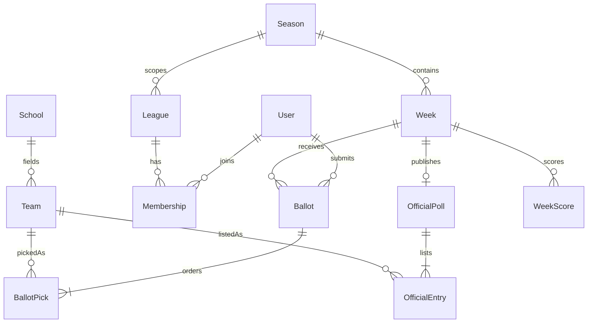
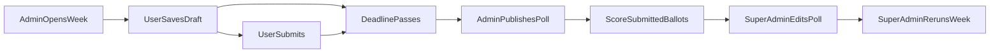

# Top 25 Picks

Working name: **Top 25**. Use that name in the UI, with a standing disclaimer that the game is independent and is not affiliated with, endorsed by, or speaking for the NCAA or The Associated Press. Have the exact wording reviewed before a public launch; “AP Top 25” is someone else’s mark, so the product name should stay generic.

Football and basketball are the same game on separate data. A user has one account. Seasons, weeks, ballots, scores, and leagues never mix across sports. Only men’s football and men’s basketball are in scope. The sport field is an enum so another sport can be added later without a rewrite.

## Stack

**Backend: FastAPI on Python 3.12, managed with uv.** It is the best fit for this app because the API, validation, and admin documentation come from the same Pydantic models. SQLAlchemy 2 and Alembic own persistence. Scoring lives in one Python module with tests, and the server is the only place a score is calculated.

**Frontend: React, TypeScript, Vite, React Router, and Tailwind CSS.** The Python app is the backend, so the UI should be a static single-page app rather than a second server. Vite is fast to run and straightforward to debug in VS Code. Drag and drop uses `@dnd-kit` (sortable list, drag overlay, animated item shifts, a clear drop slot). Respect `prefers-reduced-motion`. Each row also has up/down controls so a phone is usable when a drag is awkward.

**Contract: JSON over HTTP, cookie session, OpenAPI types.** The browser calls `/api/...`. In local dev, Vite proxies that to FastAPI so the app and API share one origin. Production uses the same idea: the site on one host, `/api` routed to FastAPI. Sessions are random tokens stored hashed in Postgres, sent in an `HttpOnly` cookie. Unsafe requests also send a CSRF header. Generate TypeScript types from the OpenAPI schema so request shapes stay aligned.

Admin and super admin can open Swagger at `/api/docs` and ReDoc at `/api/redoc`. Everyone else gets 404. Local `.env` can set `DOCS_PUBLIC=true` so docs are open while developing.

## How to run it locally

Layout:

- [Makefile](Makefile) at the repo root
- [docker-compose.yml](docker-compose.yml) for Postgres and Mailpit
- [backend/](backend/) FastAPI app, Alembic, pytest
- [frontend/](frontend/) Vite app
- [.vscode/launch.json](.vscode/launch.json) compound config: debugpy for FastAPI, Chrome for Vite
- [.env.example](.env.example) checked in; real `.env` ignored

Makefile targets:

- `make setup` creates the Python env, installs npm packages, copies `.env.example` if needed, and starts Postgres and Mailpit
- `make dev` starts Postgres, Mailpit, `uvicorn --reload`, and Vite
- `make backend` and `make frontend` start one side
- `make migrate` applies Alembic migrations
- `make revision msg="..."` creates a migration
- `make test` runs pytest, including scoring tests
- `make lint` runs Ruff and the frontend typecheck
- `make seed` creates the first super admin from `SUPERADMIN_EMAIL` plus a tiny set of schools for both sports
- `make down` stops containers

Mailpit UI at `http://localhost:8025` shows magic links and password resets. App at `http://localhost:5173`. API at `http://localhost:8000`. Debug from VS Code with the compound launch config instead of attaching by hand.

## Persistence and hosting

**Postgres everywhere.** Local Docker Postgres matches production. Neon’s free Postgres is the hosted database: it stays up when the API is quiet, and Alembic is the only schema path.

**Recommended hosting, aimed at a few dollars a month until the game has real traffic:**

- Frontend static files on Cloudflare Pages
- FastAPI on Fly.io (small always-on machine so login is not waiting on a cold start)
- Neon Postgres
- Cloudflare in front of the domain, sending `/api` to Fly and everything else to Pages, so cookies stay first-party
- Resend for magic links and password reset (free tier is enough to start)
- Google OAuth client in Google Cloud Console, with redirect URLs for `http://localhost:8000/api/auth/google/callback` and the production API callback. The client secret stays on the API only

Logo files in version 1 go to Cloudflare R2 (S3-compatible). Locally they go to a folder on disk. If a logo URL is set, the image tag uses it and switches to the uploaded file when the URL fails. The API does not fetch that URL itself.

Fly.io can be swapped for Cloud Run later without changing the app. Auth stays in our database either way, so roles and display names are not split across a second user system.

## Data model

Use one school catalog and a team row per sport. Name, abbreviation, mascot, colors, and logos live on the school, so they are entered once. A team row is “this school competes in this sport.” Duke basketball and Alabama football do not have to both exist. Polls, ballots, and school leagues point at team rows, so a sport only sees its own teams.

Core fields:

- **User:** email, password hash nullable, google subject nullable, role (`user`, `admin`, `super_admin`), display name, `display_name_set_at`, theme (`light`, `dark`, `system`)
- **School:** name, abbreviation, mascot, primary color, secondary color, logo URL nullable, logo file key nullable
- **Team:** school plus sport, active flag. Unique on school and sport
- **Season:** sport, name (for example `2026 Football`), status `upcoming`, `active`, or `archived`. One active season per sport. Scores never leave the season
- **Week:** season, number, deadline timestamp, status `open`, `locked`, or `published`
- **Ballot:** user plus week, status `draft` or `submitted`, submitted time. Unique on user and week
- **Ballot pick:** team plus rank 1 through 25, unique rank and unique team within that ballot
- **Official entry:** one row per team on that week’s poll release. Placement is `ranked` (1 through 25) or `also_receiving` (received votes, outside the top 25). Every entry stores `votes` (the total vote figure copied from the release) and `first_place_votes` (0 is allowed). A team appears at most once. Ranks 1 through 25 are unique. The also-receiving list is ordered by votes, then first-place votes, then team name
- **Week score:** user plus week, total points, proximity points, bubble points, exact-count, distance sum, JSON breakdown. Written only for submitted ballots. Exact-count and distance sum cover the official top 25 only. Bubble points are included in the total
- **League:** season, sport, kind `private` or `school`, display name, owner for private leagues, school team for school leagues, unique join code for private leagues. Private leagues are in the MVP. School leagues are version 1
- **Membership:** user plus league, `kicked` flag

Deactivate a team to hide it from new ballots. Past weeks still show it.

## Accounts, roles, and profile

Three login methods share one user row. Matching a verified email links Google, password, and magic link to the same account.

- Email and password, hashed with Argon2
- Magic link, single use, about 15 minutes, token stored hashed
- Google OAuth

Never copy a Google name or the email prefix into the public name. After the first login, the only screen is display name. Prefill a random name such as `Swift Falcon 4821`, and let them edit it. They confirm before any other page loads. Display names are unique, ignoring case. Profile later can change the display name and the theme.

Permissions stack:

- **User:** profile, ballots, standings, history, and private leagues. School leagues arrive in version 1
- **Admin:** a user, plus create weeks, set a future deadline, and publish that week’s official top 25, vote totals, and teams that received votes outside the poll
- **Super admin:** an admin, plus edit a published poll, rerun a week’s scores, grant or revoke admin, and add, edit, or retire schools and teams

`make seed` creates the first super admin. Further super admins are created from the command line. The product UI grants admin only, which matches the role you described and keeps that power out of the browser.

Theme is light, dark, or system. Store it on the user. Before login, store it in `localStorage`. System follows `prefers-color-scheme`.

## Week flow

The server enforces the deadline in UTC and shows it in the user’s local time. After the deadline, save and submit both fail. A draft that was never submitted is not scored.

On the ballot screen, a banner stays up while the ballot is a draft: these picks will not count until they are submitted. **Save** stores the current order and can be incomplete. **Submit** is enabled only for 25 distinct teams. Submit opens a confirmation that says the ballot cannot be changed afterward, and tells them to save if they are not ready. After submit, the ballot is read-only even if the deadline is still ahead.

Publishing loads the previous week’s official top 25 and that week’s also-receiving-votes list for the same season, including votes and first-place votes. The admin reorders the top 25, deletes teams, and adds teams. Below that, an **Also receiving votes** section adds or removes teams that got votes and missed the cut. Each top-25 row and each also-receiving row has two number fields: total votes and first-place votes. Week 1 starts with both lists empty. Publish requires all 25 ranks, no team on both lists, and both vote fields on every row. Publish scores every submitted ballot. A super admin can correct a published poll, including vote totals and the also-receiving list, and then rerun that week. Rerun replaces that week’s score rows from the stored ballots and the current poll.

## Scoring

Name it **Proximity Points** on the public rules page. A week score is proximity points plus a small bubble bonus. Points are never negative. A bad week adds little or nothing. It does not subtract points already earned, so one or two bad weeks leave a gap instead of a hole. Season score is the sum of that season’s week scores. A perfect top 25 is 250 proximity points. Bubble points add at most 9 more. Catching up means outscoring people in later weeks. Several bad weeks still leave a large gap, which is the intended pressure.

For each of the 25 official teams, compare the user’s rank `U` to the official rank `A`. Distance is the absolute difference.

- Team missing from the submitted ballot: 0
- Distance 0: 10
- Distance 1: 8
- Distance 2: 6
- Distance 3: 4
- Distance 4: 2
- Distance 5, 6, or 7: 1
- Distance 8 or more: 0

**Bubble points** cover teams that received votes and finished outside the top 25. Vote totals are shown to players and are not multiplied into the score, so the bonus stays small and can be checked by hand. Where you ranked that team is what changes the points:

- Your rank 23, 24, or 25: 2
- Your rank 20, 21, or 22: 1
- Your rank 1 through 19: 0

A team outside the poll that received no votes scores 0 wherever you ranked it. Ranking a vote-getter in the top 19 also scores 0 for that pick: that slot was not a near miss, and the official team you left out already scored 0 on its own. Filling ranks 20 through 25 with vote-getters who all missed the poll is 9 points (1+1+1+2+2+2), next to 250 for a perfect top 25.

Worked example on the rules page, in two parts.

Proximity, on a 5-team board so it fits on a phone. Say clearly that a real week is 25 teams and proximity maxes at 250. Official order: Duke, Kansas, Houston, Purdue, UConn. User order: Duke, Houston, Kansas, UConn, and then a team outside that board.

- Duke, exact: 10
- Kansas, off by 1: 8
- Houston, off by 1: 8
- Purdue, missing: 0
- UConn, off by 1: 8

Proximity subtotal: 34 of 50. Show this as two columns with the points beside each official team.

Bubble, as its own picture on a real 25-team ballot. Arizona received votes, missed the top 25, and the user ranked Arizona 25: 2 bubble points. Yale also received votes and missed the poll, but the user ranked Yale 8: 0 bubble points. The rules page states that bubble credit uses ranks 20 through 25 on the full ballot, and that the 5-team board above is only there to show proximity math.

The published results screen shows rank, team, votes, and first-place votes for the top 25, then the also-receiving list with the same vote columns. If the viewer submitted a ballot, show their rank and the points for that team on each row.

Store the per-team breakdown, split into proximity and bubble, so a user can open a week and check the math.

**Tiebreakers**, in order, on every leaderboard (global and private league, and later school). Ranks are unique.

1. Higher season points
2. Higher score in the most recent published week
3. More exact hits in the season
4. Lower total distance among official top-25 teams the user actually ranked. Bubble picks are left out of this step because their points already sit in the season total
5. Earlier first submitted ballot of the season
6. Lower user id, so two people cannot share a place

When a step after total points decides the order, show a short “tiebreak” note on that row. The rules page lists these steps in plain language.

Leaderboards are computed from stored week scores inside one season. “Where did I rank each week?” means cumulative score through that week, then the tiebreak rules. A rescore updates history because it is recalculated, not frozen.

## Leagues

Private leagues are part of the MVP. School leagues stay in version 1. Both belong to one season and one sport. A user can be in many at once. Standings use the same scores and tiebreakers, limited to members.

**Private league invite:** one secret, shown two ways. The owner gets a join code (10 characters, unambiguous alphabet, unique) and a link `/join/{code}`. The join screen accepts a typed code; the link only prefills it. Regenerating the code kills old links. Failed joins are rate-limited. A second password would be another secret to lose, and a short human password is easy to guess, so the code is the password.

The owner can kick a member. A kicked user stays blocked from that league until the owner allows them back, so the code alone cannot undo a kick. The owner cannot kick themselves.

**Commissioner tools, in the MVP.** Only the current owner can use them.

- **Rename.** The owner edits the display name. Season, sport, memberships, and the join code stay as they are. The name is required, up to 40 characters, and does not have to be unique.
- **Hand off ownership.** The owner chooses one current member who is not kicked, then confirms. That member becomes the only owner and can kick, rotate the code, rename, and hand off again. The previous owner stays in the league as a normal member. The league page shows the new owner. There is always one owner.

**School leagues (version 1):** any user can join or leave any school’s league for the active season and sport, including several schools. No favorite is required. The app creates the school league on the first join. The name follows the school, and there is no owner to rename or replace. Past seasons remain readable after the season is archived.

## Interface

Every page has the disclaimer in the footer. Signup includes the same sentence.

Responsive behavior:

- Phone: one column, sport switch, sticky save and submit bar, drag handle plus up/down buttons
- Tablet: the ranking list uses the width, with add-team search above it
- Laptop: ranking on one side, team search and official results (when published) on the other

The official results view lists the top 25 with votes and first-place votes, then **Also receiving votes** with the same two numbers. A submitted ballot shows the user’s rank and points on each row they touched.

Sport switch is global and remembered. Football screens only list football teams, weeks, and leagues.

Public pages: rules, disclaimer, login. Everything else waits on a confirmed display name.

## MVP

A person can sign up, name themselves, rank a week in either sport, get scored when the poll is published, see season standings and weekly movement, and run a private league.

- Monorepo, Makefile, Compose, Mailpit, VS Code debug, env example
- Auth: password, magic link, Google, linked by verified email, cookie session
- Display name gate with a random suggestion
- Roles, seeded super admin, admin grant and revoke
- Schools and teams per sport, logo URL, colors, mascot, abbreviation
- Seasons and weeks, one active season per sport, archive view of past seasons
- Deadlines, draft save, submit confirmation, server-side lock
- Drag-and-drop ballot with animated drop target
- Admin publish flow prefilled from last week, including vote totals, first-place votes, and the also-receiving-votes list
- Scoring, with proximity points plus bubble points, stored breakdowns, global standings, within-season rank history
- Public rules page with the 5-team example, the bubble example, and tiebreakers
- Super admin edit of a published poll and rerun of that week
- Theme, profile, footer disclaimer, responsive shell
- Admin-only OpenAPI docs
- Private leagues: create, rotatable join code and link, join screen, kick with rejoin block, league standings and weekly history
- Commissioner tools on private leagues: rename, and hand off ownership to a current member

## Version 1

School leagues and the remaining product polish.

- School leagues anyone can join or leave, multiple at once, archived with the season
- Logo upload plus URL-first fallback
- In-app note when a tiebreak separated two players
- Profile: set a password if they started with a magic link, connect or disconnect Google
- A small audit trail on poll edits and rescores

## Later ideas

These are out of both plans. They add challenge without throwing out the scoring page.

- Email when the deadline is near, and a recap when the poll is published
- A super-admin “double week” that multiplies that week’s points by two
- A small bonus for correctly naming a team that was unranked the week before
- Badges for a perfect top 5, a hot streak, or calling the new No. 1
- Head-to-head side bets inside a league
- League thread for the week
- Shareable standings image
- Installable phone app
- Women’s basketball as another sport value
